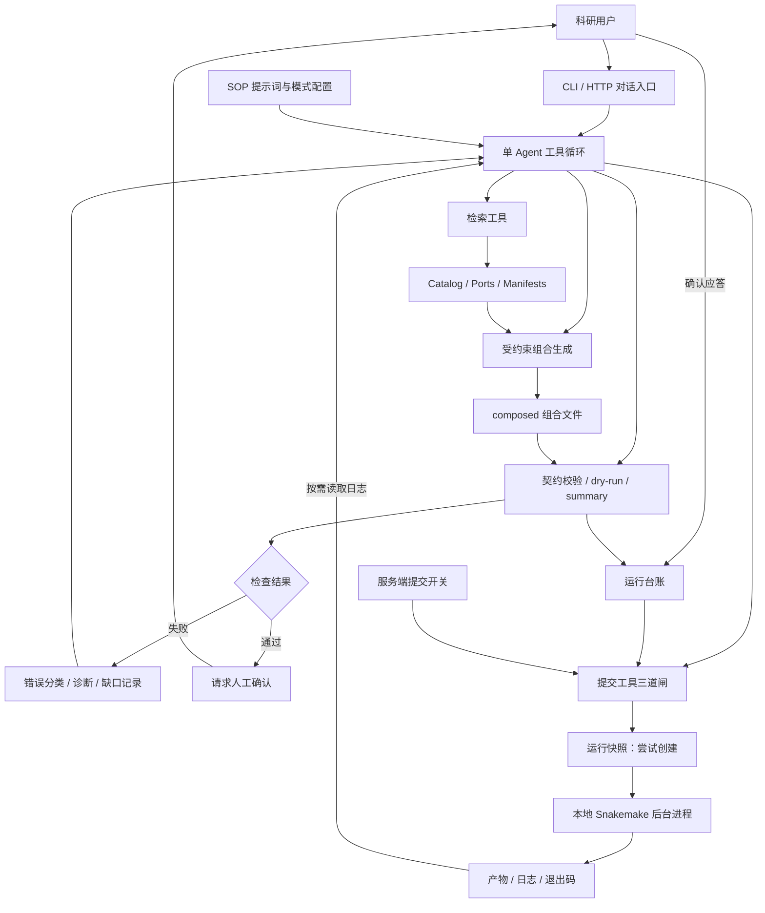
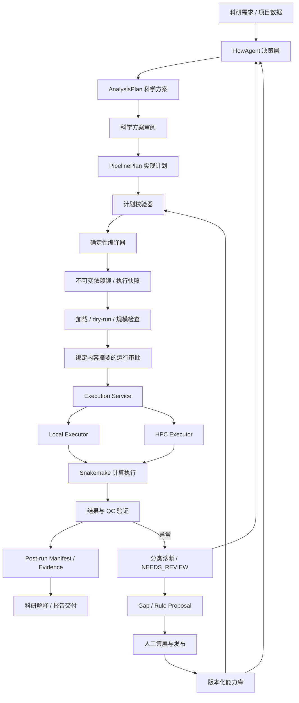

# FlowAgent 架构梳理与设计评审

审阅日期：2026-10-15（Asia/Shanghai）
仓库： https://github.com/xsx123123/FlowFrame/tree/main/FlowAgent
审阅提交：d9080f61c138c5f66e5a951af0571e1071d0b35f
边界：以克隆取得的源码为依据，未修改、提交或推送仓库源码；安装依赖并运行现有检查。本文区分当前实现、规范目标和建议。

## 1. 判断

设计方向适合标准化生信分析：LLM 负责理解需求、检索能力、提出组合与诊断建议；确定性工具负责校验和执行；人负责审核。其核心价值是把已有 Snakemake rule 库变成可对话调用、可审查的分析能力库。

当前是“单 Agent + 工具调用 + 双模式 + 受约束 Snakefile 生成”的后端原型。standard/expert 是同一 Agent 的模型、提示词和工具权限变体，并非两个独立 Agent 的协作。Snakemake 才是计算 DAG 与任务调度的执行引擎，AI SDK 管理的是 LLM 工具调用循环。

适合受控环境试点；尚不能据此认定实现了完整的确定性编译、集群调度、科学语义验证或可复现科研闭环。

## 2. 当前架构

图是逻辑流程：validate 和 summary 的顺序主要由 SOP 引导；submit 的硬闸门只查询成功 dry-run、未消费确认和部署开关。不能把图上的所有步骤理解为服务端强制状态机。

| 层 | 当前对象 | 职责 |
|---|---|---|
| 接入层 | src/cli.ts、src/server.ts | 命令行、多轮对话、HTTP 流和人工确认回传 |
| 决策层 | src/agent.ts、src/system-prompt.ts | AI SDK streamText 循环，单次调用最多 30 步；standard/expert 策略 |
| 能力索引 | src/tools/registry.ts | query_catalog、query_ports、query_rules、get_rule；按需披露 rule 详情 |
| 组合层 | src/tools/writes.ts、src/composed-guard.ts | 写组合目录；语句、表达式和路径约束；拒绝新增 rule 本体 |
| 校验层 | src/tools/validate.ts、src/tools/snakemake.ts | 资产一致性、配置约束、Snakemake dry-run、文件摘要与 rulegraph |
| 授权与审计 | src/ledger.ts | JSONL 事件、dry-run 记录、确认记录与消费计数 |
| 执行层 | src/shell.ts、submit_cluster | 固定 cores 上限，后台启动本地 Snakemake |
| 留存层 | src/run-bundle.ts | 组合与配置副本、库版本标记、bundle 清单 |
| 专家扩展 | src/tools/expert.ts | 历史复盘和 rule 提案；提案仍需人工审核入库 |

标准模式注册 12 个工具；专家模式增加 2 个工具。写入权限限制适用于 Agent 暴露的工具；正式 Snakemake 作业仍会生成正常分析产物，不是整个进程的文件系统沙箱。

## 3. 合理之处

1. 复用 rule，不让模型重写每个分析工具的执行逻辑。已有流程经验可持续沉淀为库资产。
2. 从用户要的 deliverable 反查 target，再必要时查询端口和 rule，降低常见请求的组装成本。
3. 将授权放进工具和台账，而不是只要求模型遵守提示词。
4. rule 摘要与详情分开查询，有利于规模扩大后的上下文管理。
5. 缺口写入 gap log，专家只生成 proposals，形成“使用反馈 → 策展 → 审核”的人工维护路径。
6. 以 Snakemake 承担执行职责，避免同时另造一个生信作业调度引擎。

资产仍须验证和维护。引用库内 rule 不自动证明该 rule 已科学验证，prompt 中的 SOP 也不等于全部约束已代码化。

## 4. 当前实现与目标的差距

| 事项 | 源码实际状态 | 下一步 |
|---|---|---|
| Snakefile 生成 | 模型传入完整文本，工具检查后写盘 | PipelinePlan → 校验器 → 固定模板编译 |
| AnalysisPlan | 规范有定义，src 尚未实现对应对象和审核链 | 科学目标、分组、对照、方法假设形成明确审阅对象 |
| 端口正确性 | 查询与全库一致性检查；无选中子图的完整计划校验 | 检查选中集合的闭合、属性兼容、显式路径绑定 |
| 配置校验 | 自实现类型/范围/枚举/pattern 子集；缺 key 为 warning | 校验有效合并配置；选中规则必需字段缺失则拒绝 |
| 审批绑定 | task_id + targets + workdir | 再绑定 plan/config/样本表/rule版本/资源/executor 的内容摘要 |
| 运行快照 | Git HEAD 或 manifest hash、部分文件副本；失败返回 null | 不可变锁、实际依赖与有效配置、失败阻断 |
| 集群执行 | 本地后台 Snakemake，无 HPC 适配器 | executor 接口；先实现 local，再适配 Slurm 等 |
| 运行结果 | 日志尾部退出码；台账主要记录 started | 持久任务状态、结果验证、post-run manifest |
| 科学正确性 | dry-run 主要检查加载和依赖可执行性 | 科学方案审核 + 最小真实运行 + QC 与结果校验 |

### 4.1 HTTP 确认协议存在明确不一致

src/server.ts 的 recordApprovalsFromUiMessages 只处理 part.state === 'output'。实际安装的 AI SDK v5 的 ToolUIPart 结果状态为 'output-available'。标准 addToolResult 回传路径因此可能无法落确认台账。应按实际 SDK 协议修复，并做一次真实前后端确认往返验收。

更长期的问题是服务端直接从客户端提交的历史消息提取批准记录。Bearer 鉴权只能识别持有凭据的调用方，不能证明其确认过指定内容。平台化后，应保存服务端 pending approval，再由带身份的审批接口验证对象摘要、有效期、权限与一次性消费。

### 4.2 授权和运行必须针对相同内容

hasSuccessfulDryRun 查的是历史上是否有某个匹配任务成功，不检查之后文件有无改变；资源参数也可在 submit 阶段新增。因此同一目录下改配置、样本表或资源后，旧 dry-run 与旧确认仍可能匹配。

应生成 execution_spec_digest，覆盖所有会影响本次运行的计划、有效配置、样本表、依赖版本、资源和 executor。检查、审批和提交必须核对同一摘要。避免“确认 A，执行 B”。

hasUnconsumedApproval 用批准次数与 started 次数比较；并发请求之间存在异步创建 bundle 的窗口，尚非事务化消费。应以事务完成确认预占/消费和 run 创建，而不是只比较次数。

### 4.3 快照尚不足以保证复现

createRunBundle：
- Git HEAD 不包含未提交源码变动；
- 非 Git 情况只 hash manifests，不能识别执行脚本、环境等改变；
- 样本表仅复制固定命名的几个文件；
- 不完整记录有效配置、环境锁、参考数据、完整执行参数和实际使用依赖；
- 同 task_id 复用相同 bundle 路径，可能覆盖历史；
- 创建失败被吞掉，仍然提交；
- 后台运行仍读取原工作目录，不是从冻结 bundle 执行。

建议使用独立 run_id、不可变 bundle，并从被冻结的对象执行。输入大文件可记录受控引用、内容摘要和校验状态，无需每次复制全部数据。加入 post-run manifest 记录动态展开、实际产物、校验指标与结果状态。

### 4.4 自修复需要划清边界

当前错误分类和工具提示支持按需诊断/重试，但没有独立持久化监控器，不能等同于完整无人值守恢复服务。
同签名熔断在 dry-run 执行失败后才判断：第三次命令实际上已经执行；再次调用仍会先执行。若要求硬性阻止，应增加任务故障状态，在下一次操作前检查，授权重置或计划变更后解除。

允许确定性重试的动作应限于已审批策略，例如同一冻结计划的瞬态失败续跑；改变科学参数、输入、rule 链需新 revision 和重新审阅。避免将数据错误视作可不断重试的环境错误。

### 4.5 若干较小问题

- tierRollup 对带前缀的 rule 使用名称包含匹配后返回 rule 名，没有再查询 tierOf，可能把规则名当成资源档位。
- safeJoin 主要做词法路径边界，组合 guard 才有部分 realpath 检查；read_log 等路径仍需核对符号链接与真实文件身份。
- conda 预建是否真正发生须在目标 Snakemake 版本实测，不能仅依据参数名称推断。
- README、规范和当前脚本中自测计数分别出现 42、46 和实际 50，需要统一。
- HTTP 每次请求使用客户端传入历史，JSONL 也只是事件记录；当前没有完整服务端会话/任务恢复状态机。

旧差距审核文档列出的 G1 路径覆盖逃逸、G2 合法语法误拒，当前 guard 与新增用例已覆盖；不能直接把旧文档问题当成当前未修复事实。

## 5. 建议目标架构

这是目标图，不能标成已实现。现有索引、工具、guard、台账和 Snakemake 封装可复用；AnalysisPlan、PipelinePlan 校验/编译、完整锁、事务审批、执行服务、HPC、结果验证与 Evidence 对接需要新增或显著增强。

科学方案审阅与运行审批是两种职责：前者判断方法/对照/参数是否合适；后者批准某个冻结执行对象和资源开销。已审核标准 pipeline 的重复运行可采用版本化策略复用科学审核，不必让所有相同任务反复从零审批。

## 6. 与平台的职责关系建议

| 组件 | 建议职责 |
|---|---|
| CygnusX | 项目上下文、身份权限、审批、任务状态、资产和证据组织 |
| 科研寻宝鼠 | 数据与文献发现 |
| polariseq | 数据获取 |
| FlowAgent | 分析方案/实现计划、能力选择、诊断建议 |
| FlowFrame / Snakemake | rule 资产和标准计算执行 |
| 下游领域 Agent | 在可验证分析产物上做深入探索与领域解释 |
| BioReport | 按已验证产物生成报告 |

这是职责建议，不表示此次已核验这些模块之间的真实集成。将本 Agent 定位为分析中心的受控流程编排模块比较合理；领域探索可迭代，但写回或正式执行仍应走同一执行服务和证据机制。

## 7. 实施优先级

1. 修复 SDK 确认协议、类型检查和资源档位汇总；真实验证 CLI/HTTP 两条人工确认链。
2. 审批绑定有效执行对象摘要；事务化一次性消费；快照失败阻断；run_id 与不可变目录。
3. 优先支持已验证 existing_entry；实现最小 PipelinePlan、选中子图校验和编译器；遇到不能表达的需求记录缺口。
4. 明确生产 rule 的 samples/config/logger 等 bootstrap 契约；再开放跨模块编译，不能仅凭 demo 推断所有真实流程可组合。
5. 持久任务状态、完成事件、输出/QC 验证、post-run manifest。
6. 接入平台身份与审批服务，然后适配集群。
7. 扩展语义错误与真实流程评测，并分别建立 standard/expert 基线。

## 8. 本次验证

- npm ci --ignore-scripts：成功。
- npm run typecheck：失败，两处均在 scripts/validate-repo.ts：TS5097 导入 .ts 扩展未开启相应选项；TS2339 将工具可能的 AsyncIterable 返回类型直接作为有 ok 属性的对象。
- npm run selftest：tsx CLI 因环境 IPC socket 权限失败。
- node --import tsx scripts/selftest.ts：成功启动现有测试，50 项中 43 通过、7 失败。失败涉及 Snakemake 调用与依赖后续步骤；本环境没有 snakemake，不能据此判定对应功能实现有缺陷，也不能宣布全套通过。
- 未调用外部 LLM，未进行完整组学分析、HPC、真实前端审批或真实库跨模块端到端验证。

## 9. 适合 README 的定位

FlowAgent 是面向 FlowFrame 的受控生信流程编排后端。它将自然语言需求映射到版本化分析能力，由 LLM 检索已有 rule、提出组合并诊断错误，由工具层完成约束校验、运行授权与审计，由 Snakemake 执行计算任务。当前实现支持标准/专家双模式、受约束组合生成、人工确认和运行快照；后续向结构化计划、确定性编译、不可变执行锁和结果证据验证演进。

一句话检查点：把模型的判断变成可审查的计划，把每次计算变成与批准内容一致、可验证的执行记录。

